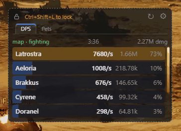
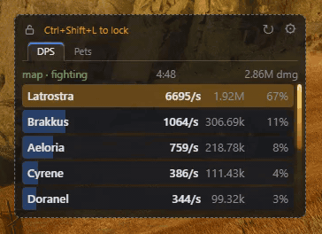
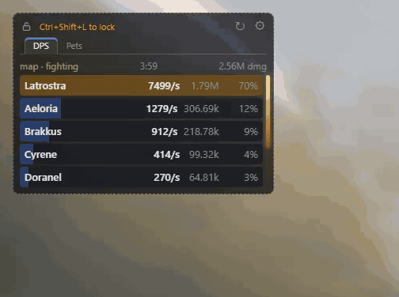
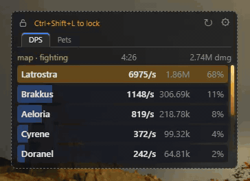
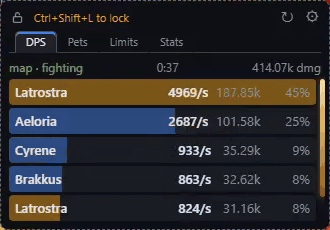
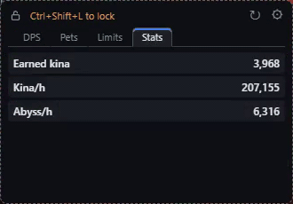
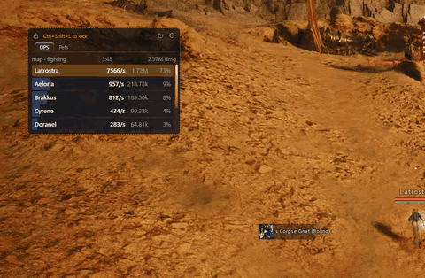
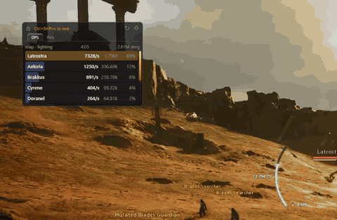
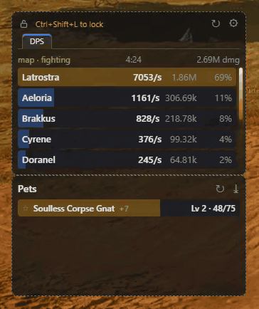

# aion2-metric

DPS meter and pet soul tracker for AION 2 (Windows, EU servers). It shows a small transparent
overlay on top of the game with your damage, your party's damage, the progress of the pets
you are collecting, your daily limits and the kina you earn.

It only listens to the game's network traffic on your PC. It never reads game memory, never
injects anything, never sends anything to the game and opens no network ports.

## What it looks like

| | |
|---|---|
| **Live DPS and pet tabs**<br> | **Lock**: buttons and other tabs hide, clicks go through to the game<br> |
| **Resize**: rows and text scale with the window<br> | **Settings**<br> |
| **Daily limits**: kina, abyss points, gathering<br> | **Stats**: earned kina, kina/h, abyss/h, ↻ resets<br> |

**Move and resize anywhere over the game**



**Drag a tab out into its own window and dock it to another window**



**Put it back as a tab**



## User guide

### Before the first start

1. Install [Npcap](https://npcap.com). During installation leave
   **"Restrict driver access to Administrators only"** unticked. If you tick it, start the
   overlay as administrator.
2. Start `a2m-overlay.exe`.
3. Start the overlay **before you log in your character**. The game sends your pet collection
   and daily limits only at login. If the overlay starts later, the Pets and Limits tabs ask
   you to relog.

### The window

- **Move**: drag the window anywhere. **Resize**: drag its edges.
- **Header**: the open padlock locks the window, ↻ resets the open tab (fight on DPS, earned kina and rates on Stats), ⚙ opens settings.
- **Tabs**: **DPS**, **Pets**, **Limits** and **Stats**. Click a tab to switch.
- **Lock**: click the padlock or press **Ctrl+Shift+L**. A locked window stays in place,
  hides its buttons and the other tabs, and lets clicks through to the game. Press the shortcut again to unlock.
- **Tray icon**: lock / unlock, show / hide, quit.
- The overlay hides itself while the game is not the active window and comes back when you
  return to the game. You can turn this off in settings.
- Position, size and layout are remembered between runs.

### DPS tab

Each row is one player: name, DPS, damage and share of the visible damage. The second line
shows the other DPS values, hits, crit rate, highest hit and pet damage.

- **Colors**: you, your party, other players, pets without an owner.
- **Top line**: fight state, fight time and total damage of the players you see.
- A name shows as **…** until the game sends it.
- **↻** starts counting from zero.

DPS values (choose the main one in settings):

| value | meaning |
|---|---|
| Average | damage divided by fight time |
| Rolling | damage from the last few seconds |
| Active | damage divided by the time from your first to your last hit |

Counting modes:

- **Whole map**: everything until you change the map.
- **Per fight**: a new fight starts after a few seconds without damage.

### Pets tab

- A pet appears when you pick up its soul, newest at the top.
- Each row shows the pet level and souls collected / souls needed for the next level.
- Click **☆** to pin a pet to the top. Pinned pets stay even without new souls.
- **"Relog your character to load pet progress."**: the overlay was started after login.
  Relog your character once.

### Limits tab

Shows how much you already have today and the limit:

- **Kina today**: kina gained today / 1,000,000
- **Abyss points**: abyss points / limit
- **Gathering today**: gathered today / 1,000

Values update as you gain kina, abyss points or gather. If a value shows **?**, gain some of it
or relog your character while the overlay is running.

### Stats tab

- **Earned kina**: all kina you gained since the overlay started or since **↻**
  (mobs everywhere, Abyss included). Spending does not lower it. Selling and trading also count.
- **Kina/h** and **Abyss/h**: how much you would earn in an hour at the same rate. Shown
  after one minute.

Counting starts after the first kina change, or right away if you log in with the overlay
running.

### Separate windows and docking

- Drag a tab out of the main window to open it as a separate window.
- Drop a window next to the edge of another window to dock it. Docked windows move together
  with the main window. Drag a window away to undock it.
- Drop a window on the tab bar of the main window, or click **⤓**, to put it back as a tab.

### Settings (⚙)

| tab | options |
|---|---|
| Display | background and text opacity, number of rows, details line, colors |
| DPS | counting mode, fight end time, main DPS value, rolling window length |
| Filters | show yourself, party, other players, pets without an owner, named players only, max rows |
| General | language (English / Polski), lock shortcut, hide outside game |

Hidden players are not counted in the total damage and shares.
**Reset tab** restores the defaults of the open settings tab.

### Troubleshooting

| problem | what to do |
|---|---|
| "Connecting…" or nothing happens | install Npcap, or start the overlay as administrator; make sure the game is running |
| the overlay disappeared | click the game window, use show / hide in the tray, or turn off "Hide outside game" |
| pets or limits show "?" or the relog message | relog your character while the overlay is running |
| a name stays "…" | wait, the name arrives when the game sends that player's info |

## For developers

Requirements: [Npcap](https://npcap.com) (no Npcap SDK needed to build), Rust stable,
`cargo install trunk`, `rustup target add wasm32-unknown-unknown`.

### Overlay

The overlay embeds the web UI at compile time, so build the UI first.

```
cd crates/meter-web && trunk build --release && cd ../..
cargo build --release -p meter-overlay
target/release/a2m-overlay.exe
```

Replay a recording instead of the live game:

```
target/release/a2m-overlay.exe --replay captures/session.pcap --speed 10
```

### CLI tools

```
cargo run -p meter-agent -- devices
cargo run -p meter-agent -- conns
cargo run -p meter-agent -- live --record captures/session.pcap --quiet
cargo run -p meter-agent -- stats captures/session.pcap
cargo run -p meter-agent -- dump captures/session.pcap --opcode 0438
cargo run -p meter-agent -- events captures/session.pcap
```

`captures/*.pcap` contain character names. Never commit or publish them.

### Layout

- `crates/meter-proto`: snapshot types shared by agent and UI
- `crates/meter-core`: IPv4/TCP, TCP reassembly, game frames (varint + LZ4), opcodes,
  packet parser, combat meter
- `crates/meter-capture`: Npcap live/offline capture, AION 2 process and connections
- `crates/meter-agent`: meter engine used by the overlay, `a2m` CLI tools
- `crates/meter-web`: Leptos UI of the overlay windows, built with trunk
- `crates/meter-overlay`: Tauri v2 overlay `a2m-overlay`, embeds the UI and runs the meter

See `AGENTS.md` for project rules and protocol notes.

Protocol facts come from public observations of other open-source meters; the code here is
written independently and licensed MIT.
